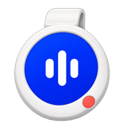

# Vibe Mic Pro

**English** · [简体中文](README.zh-CN.md)



**Turn the Insta360 Mic Pro power button into a dictation shortcut. Tap once to start, tap again to stop, and speak with your hands off the keyboard.**

Vibe Mic Pro is an independent macOS menu bar app for the Insta360 Mic Pro (MC110) transmitter. It maps a short press of the power button to Right Option (⌥), which triggers hands-free dictation in Doubao Input Method. When the transmitter turns off or disconnects, Doubao follows the system input back to the Mac's built-in microphone or another selected input device.

[Download for macOS](https://github.com/kingshijie/insta360-mic-pro-vibe/releases/latest) · [Installation guide](#installation)

## Requirements

- macOS 13 or later. Tested on an Apple silicon MacBook Pro running macOS 14.7.8. Other Mac models and macOS versions have not been tested.
- An Insta360 Mic Pro transmitter paired directly with the Mac over Bluetooth. Look for a device named `Insta360 Mic Pro TX …`.
- [Doubao Input Method for macOS](https://ime.doubao.com/pc) and [BlackHole 2ch](https://existential.audio/blackhole/). Restart if the BlackHole installer asks you to.

## Installation

1. Under **Assets** on the [latest release](https://github.com/kingshijie/insta360-mic-pro-vibe/releases/latest), download **`MicPro-Doubao-macOS-universal.zip`**. Unzip it, drag the extracted app into Applications, and open it. The ZIP contains a prebuilt app for Apple silicon and Intel Macs.
2. The app is not notarized by Apple. If macOS blocks it because it cannot verify the developer, dismiss the alert, then go to **System Settings → Privacy & Security** and select **Open Anyway** for this app. [Apple's instructions](https://support.apple.com/en-us/102445)
3. Under **System Settings → Privacy & Security → Accessibility**, enable the extracted app. If it is missing, use **+** to add it from Applications. Allow Bluetooth access if prompted.
4. In Doubao Input Method's voice input settings, set the hands-free shortcut to **Right Option (⌥)** and the microphone to **Automatic**. To trigger dictation while another input method is active, enable the global voice input option.

Doubao settings may show Chinese labels. The [Chinese setup guide](README.zh-CN.md#安装) lists the labels as they appear on screen.

### Build from source

1. Install the Xcode Command Line Tools with `xcode-select --install` if they are not already installed.
2. Clone and build. The first build downloads the pinned version of liblc3.

   ```sh
   git clone https://github.com/kingshijie/insta360-mic-pro-vibe.git
   cd insta360-mic-pro-vibe
   ./build.zsh
   ```

   The script prints the installed app's path in your user Applications folder. Open the app and follow the Accessibility and Doubao steps above.

## Usage

| State | Doubao input | How to dictate |
| --- | --- | --- |
| Mic Pro is connected and the app is ready | Mic Pro through BlackHole 2ch | Focus a text field, tap the power button to start, and tap it again to stop. |
| Mic Pro is off, disconnected, or the bridge is paused | Built-in microphone or another selected input device | Use Doubao's own dictation shortcut, such as holding Right Command if configured. |

The app runs in the menu bar and starts at login by default. Use its settings to disable login launch. The menu also shows the current input and lets you pause the bridge or reconnect.

Vibe Mic Pro starts in English by default. To switch to Simplified Chinese, open **Settings → Language** and choose **简体中文**. The change applies immediately and is saved for next time. You can also reopen the running app from Finder to bring up Settings.

**Double-press the power button to send Return** is enabled by default. You can turn it off in Settings. Tap once to start and once to stop in the same app. Wait for the text to appear, then double-press within 20 seconds of stopping. This also toggles the transmitter's noise reduction. Return submits only in fields configured to send on Return.

BlackHole is a virtual audio device. The app decodes the incoming Mic Pro audio locally and sends it to BlackHole. Once audio arrives, the app switches the system input to BlackHole and restores the fallback input on disconnect. This also affects other apps that follow the system's default input.

## Troubleshooting

| Symptom | What to check |
| --- | --- |
| The menu bar icon is missing | Open the app from Applications. If the MacBook menu bar is crowded, free up some space near the notch and look for the white round pixel-art face. A dim icon means the microphone is not ready. |
| The app stays idle | Check Bluetooth pairing, BlackHole 2ch, and Accessibility access. Retry from the menu. If the transmitter connects without sending audio, quit other apps using it and restart the transmitter. |
| The power button responds, but Doubao produces no text | Tap Right Option in a text field to check that Doubao enters hands-free mode. Set the microphone to Automatic. It should show BlackHole 2ch when the bridge is ready and the fallback input after disconnecting. |
| The power button stops working after an update | The app uses an ad hoc signature. Remove the old Accessibility entry, add the updated app, then quit and reopen it. |
| The system input does not switch back | Quit from the app menu. If the app was force-quit, select the built-in microphone in **System Settings → Sound → Input**. |

To upgrade, quit the old app and replace it with the latest download. If you installed from source, run `git pull` and `./build.zsh`. To build without installing, run `./build.zsh --build-only`; the app will be in `build/`.

To uninstall, disable launch at login in the app settings, quit the app, and move it to the Trash. BlackHole is installed separately and may be used by other apps.

## Implementation and licenses

`panel.m` manages the menu, connections, and system audio input. `bridge.m` reads button events and audio on Bluetooth RFCOMM channel 12 and maps short presses to Right Option. `serial-audio.m` decodes 48 kHz mono LC3plus audio and sends it to BlackHole via Core Audio. The bridge handles audio on your Mac, and Doubao handles speech recognition.

The project code, documentation, and icon are under the [MIT license](LICENSE). The app bundles [liblc3 1.1.3 under Apache 2.0](https://github.com/google/liblc3/blob/v1.1.3/LICENSE). BlackHole is installed separately under the [GPL-3.0 license](https://github.com/ExistentialAudio/BlackHole/blob/master/LICENSE).
